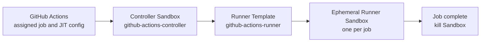

<div align="center">

# Novita Actions Runner Controller

Run every GitHub Actions job in an isolated Novita Sandbox, more affordably
and with less operational overhead.

[English](https://github.com/novitalabs/github-actions-runner-controller/blob/main/README.md) | [中文](https://github.com/novitalabs/github-actions-runner-controller/blob/main/README.zh.md)


</div>

This controller uses GitHub's official
[`github.com/actions/scaleset`](https://github.com/actions/scaleset) client to
receive assigned jobs and desired runner capacity. A long-running controller
creates one fresh Novita runner Sandbox for each job and kills it when the job
finishes.

> v0.1 uses the Scale Set API, which GitHub currently labels Public Preview.
> The client API is stable, but its Go interfaces may evolve. This repository
> pins `github.com/actions/scaleset v0.5.0`.

## Architecture



The same controller implementation supports two control-plane placements.
Novita Hosted is the recommended default because the controller remains online
without depending on a user's machine:

- **Novita Hosted:** run that controller image in a long-running Control
  Sandbox, which creates separate ephemeral runner Sandboxes.
- **Local Docker:** run the same controller image on a user's machine with
  credentials supplied through environment variables.

The runner JIT configuration travels over the adapter's stdin and the Sandbox
filesystem API. The adapter atomically publishes the completed file; the runner
entrypoint reads and unlinks it, then exports it only to the runner child
process as `ACTIONS_RUNNER_INPUT_JITCONFIG`. It is never included in Sandbox
creation environment values, metadata, process arguments, or controller logs.

## Recommended: Novita Hosted

Hosted mode uses these public Novita Templates directly; users do not build
either Template:

| Role | Public Template |
|---|---|
| Control Sandbox | `github-actions-controller` |
| Ephemeral CI runner | `github-actions-runner` |

### Before deployment

Prepare the following on the machine where you run the deployment script:

- Bash and Python 3.
- Node.js 20+ and npm if the `novita` CLI is not already installed.
- The latest `novita` CLI (version 2.1.0 or newer). The `NOVITA_API_KEY` below selects the Novita team
  that will own the Control Sandbox and brokered Secrets; a separate browser
  login is not required.
- A GitHub PAT that can manage self-hosted runners. For a classic PAT, use
  `repo` for a repository target or `admin:org` for an organization target.
  For a fine-grained PAT, grant repository `Administration: read and write` or
  organization `Administration: read` plus
  `Self-hosted runners: read and write`, respectively.
- The exact repository or organization URL to register, such as
  `https://github.com/novitalabs/github-actions-runner-controller`.

Install and verify the CLI if needed:

```bash
npm install --global novita-sandbox-cli@latest
novita --version
```

Export the three required values in the current shell. Do not put them in the
repository:

```bash
export GITHUB_CONFIG_URL=https://github.com/OWNER/REPOSITORY
export GITHUB_TOKEN=YOUR_GITHUB_PAT
export NOVITA_API_KEY=YOUR_NOVITA_API_KEY
```

Verify that the CLI sees the intended team before deployment:

```bash
novita auth info
```

`GITHUB_CONFIG_URL` is mandatory. The script rejects the example
`OWNER/REPO` and `OWNER/REPOSITORY` placeholders so it cannot silently deploy
against an unintended target.

### Deploy

Clone this repository and run the Hosted deployment:

```bash
git clone https://github.com/novitalabs/github-actions-runner-controller.git
cd github-actions-runner-controller
bash scripts/deploy-hosted.sh
```

After `cd`, run the deployment script from the cloned
`github-actions-runner-controller/` repository root. The script runs on your
machine and creates the long-running Controller Sandbox in Novita.

Success returns the stable target identity, Control Sandbox ID, and health state:

```json
{"targetId":"novitalabs-github-action-a814d8991e","controllerId":"novita-hosted-novitalabs-github-action-a814d8991e","sandboxId":"...","healthy":true}
```

The default Scale Set label is `novita-scale-set`. In the target repository,
create or update `.github/workflows/ci.yml` (or another workflow file under
`.github/workflows/`) and point each job that should use Novita at this label:

```yaml
# .github/workflows/ci.yml
jobs:
  test:
    runs-on: novita-scale-set
```

The controller creates or reuses the named Scale Set. It intentionally does
not delete it on shutdown, allowing safe controller restarts.

The deployment script creates or updates two brokered Secrets and starts a
long-running Control Sandbox with a 60-year timeout and
`pause + auto-resume`. It uses the public controller Template and creates job
Sandboxes from the public runner Template. The Secrets must remain active for
the full life of the resumable Control Sandbox. Kill that Sandbox before
deleting them.
After Sandbox creation, the script starts the controller through the Sandbox
command API and waits for `/healthz`; this is required because a process saved
in a template build snapshot does not inherit creation-time environment values.

### Multiple repositories or organizations

Run the deployment once for each GitHub repository or organization. By
default, the script derives a stable target ID from the normalized
`GITHUB_CONFIG_URL`. Each target receives its own controller identity, brokered
Secrets, and long-running Control Sandbox, so deploying another target cannot
reuse the first target's controller or overwrite its GitHub credential.

```bash
GITHUB_CONFIG_URL=https://github.com/novitalabs/github-actions-runner-controller \
  bash scripts/deploy-hosted.sh
```

To add another project, replace `GITHUB_CONFIG_URL` with that repository or
organization URL and run the same command again.

Save the JSON output for operations. The resume script accepts either the
exact Sandbox ID or the same GitHub target URL. Target-based lookup checks both
running and paused Sandboxes and fails on duplicates instead of choosing one
arbitrarily. Control Sandboxes created before target metadata was introduced
must still be resumed by their Sandbox ID.

When resuming manually, always preserve the intended lifetime:

```bash
scripts/resume-hosted.sh SANDBOX_ID
GITHUB_CONFIG_URL=https://github.com/novitalabs/github-actions-runner-controller \
  scripts/resume-hosted.sh
# equivalent core command:
novita sandbox resume SANDBOX_ID --timeout 525600h
```

Without `--timeout`, Novita resets a resumed Sandbox to its short default
lifetime (about five minutes). The lifecycle remains `pause + auto-resume`, but
the controller would pause again almost immediately.

Local Docker and Hosted mode use the same controller OCI image. Hosted users
use the two public Template names above; the Template definitions pin an
immutable image version rather than `latest`.

## Alternative: Local Docker

Use Local mode when the controller should run on a machine you manage. Prepare
Docker, the same GitHub PAT and Novita API key described above, then run:

```bash
cp .env.example .env
# Edit .env; it is ignored by Git.
docker compose up -d
curl http://127.0.0.1:8080/healthz
```

Local mode pulls the immutable
`novitalabs/github-actions-controller:v0.1.1` image. Credentials are provided
only through `GITHUB_TOKEN` and `NOVITA_API_KEY` in `.env`. Use the same
`runs-on: novita-scale-set` workflow configuration shown above.

## Scaling and recovery semantics

- Desired runners are `min(MAX_RUNNERS, MIN_RUNNERS + TotalAssignedJobs)`.
- Job availability is acquired before provisioning. GitHub can redeliver an
  unacknowledged message; a stable pending runner name and metadata lookup make
  create retries idempotent.
- Job completion permanently kills its ephemeral Sandbox.
- A periodic reconcile converges capacity even during quiet message polls.
- Only controller-owned, paused Sandboxes older than `ORPHAN_GRACE` are orphan
  candidates. Unknown running Sandboxes are preserved because they may be busy
  after a controller restart.
- `/healthz` reports process health; `/metrics` exposes creation, deletion, and
  error counters in Prometheus text format.

## Configuration

| Variable | Default | Meaning |
|---|---:|---|
| `GITHUB_CONFIG_URL` | required | Repository or organization URL |
| `GITHUB_TOKEN` | required | GitHub PAT |
| `NOVITA_API_KEY` | required by SDK | Novita team API key |
| `NOVITA_RUNNER_TEMPLATE` | required | Built runner template name or ID |
| `SCALE_SET_NAME` | `novita` | Scale Set name |
| `RUNNER_LABELS` | Scale Set name | Comma-separated labels |
| `RUNNER_GROUP` | `default` | GitHub runner group |
| `MIN_RUNNERS` / `MAX_RUNNERS` | `0` / `10` | Capacity bounds |
| `RUNNER_TIMEOUT` | `1h` | Per-job Sandbox hard lifetime |
| `RECONCILE_INTERVAL` | `30s` | Periodic convergence interval |
| `ORPHAN_GRACE` | `15m` | Paused orphan retention |
| `CONTROLLER_ID` | derived from target URL in Hosted mode | Ownership identity |
| `METRICS_ADDR` | `:8080` | Health and metrics listen address |
| `PYTHON` | `python3` | Python executable for the adapter |
| `NOVITA_ADAPTER` | `/app/provisioner/novita/adapter.py` | Adapter path |

Hosted deployment also accepts `CONTROLLER_TEMPLATE`, `GITHUB_SECRET_NAME`,
`NOVITA_SECRET_NAME`, and `CONTROL_TIMEOUT`. Explicit identity or Secret name
overrides are intended for advanced operation; the per-target
defaults are safer for normal multi-project deployments. `CONTROL_TIMEOUT`
controls the lifetime used during deployment and by `scripts/resume-hosted.sh`.

## Documentation

See [Design notes](docs/design.md) for lifecycle ownership and failure
boundaries.

## License

Licensed under the [MIT License](LICENSE).
