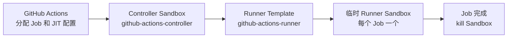

<div align="center">

# Novita Actions Runner Controller

以更低成本、更便捷的方式，让每个 GitHub Actions Job 都运行在独立的 Novita
Sandbox 中。

[English](https://github.com/novitalabs/github-actions-runner-controller/blob/main/README.md) | [中文](https://github.com/novitalabs/github-actions-runner-controller/blob/main/README.zh.md)


</div>

这是一个基于 GitHub Actions Runner Scale Set API 的控制器。它使用 GitHub
官方 `github.com/actions/scaleset` 客户端接收 Job 和 Runner 容量需求。长时
运行的 Controller 会为每个 Job 创建一个全新的 Novita Runner Sandbox，
任务结束后立即 kill。

> v0.1 使用 GitHub 当前标记为 Public Preview 的 Scale Set API，并固定依赖
> `github.com/actions/scaleset v0.5.0`。

## 架构



## 推荐：Novita Hosted

Controller 运行在长时运行的 Novita Control Sandbox 中，再为
每个 Job 创建临时 Runner Sandbox。Hosted 用户直接使用以下公共 Template，
无需构建镜像或 Template：

| 用途 | 公共 Template |
|---|---|
| Control Sandbox | `github-actions-controller` |
| 临时 CI Runner | `github-actions-runner` |

### 部署前准备

在执行部署脚本的机器上准备：

- Bash 和 Python 3。
- 如果尚未安装 `novita` CLI，还需要 Node.js 20+ 和 npm。
- 最新版 `novita` CLI（最低支持 2.1.0）。下面的 `NOVITA_API_KEY` 会选择持有 Control
  Sandbox 和 brokered Secret 的 Novita Team，不需要额外浏览器登录。
- 有权管理自托管 Runner 的 GitHub PAT。经典 PAT：仓库级目标使用 `repo`，
  组织级目标使用 `admin:org`；细粒度 PAT：分别授予仓库
  `Administration: read and write`，或为组织同时授予
  `Administration: read` 和 `Self-hosted runners: read and write`。
- 要注册的准确仓库或组织 URL，例如
  `https://github.com/novitalabs/github-actions-runner-controller`。

如未安装 CLI：

```bash
npm install --global novita-sandbox-cli@latest
novita --version
```

在当前 Shell 导出三个必填值，不要写入仓库：

```bash
export GITHUB_CONFIG_URL=https://github.com/OWNER/REPOSITORY
export GITHUB_TOKEN=YOUR_GITHUB_PAT
export NOVITA_API_KEY=YOUR_NOVITA_API_KEY
```

部署前确认 CLI 识别到目标 Team：

```bash
novita auth info
```

`GITHUB_CONFIG_URL` 必须显式配置。脚本会拒绝 `OWNER/REPO` 和
`OWNER/REPOSITORY` 示例占位符，避免误部署到错误目标。

### 部署

```bash
git clone https://github.com/novitalabs/github-actions-runner-controller.git
cd github-actions-runner-controller
bash scripts/deploy-hosted.sh
```

执行 `cd` 后，在克隆得到的 `github-actions-runner-controller/` 仓库根目录运行
部署脚本。脚本运行在本机，并在 Novita 中创建长时运行的 Controller Sandbox。

部署成功会返回稳定的目标标识、Control Sandbox ID 和健康状态：

```json
{"targetId":"novitalabs-github-action-a814d8991e","controllerId":"novita-hosted-novitalabs-github-action-a814d8991e","sandboxId":"...","healthy":true}
```

部署脚本会创建或更新两个 brokered Secret，并创建一个 60 年超时、
`pause + auto-resume` 的长时运行 Control Sandbox。Secret 是这个可恢复
Sandbox 的长期依赖；必须先 kill Control Sandbox，之后才能删除 Secret。

默认 Scale Set 标签为 `novita-scale-set`。在接入 CI 的目标仓库中创建或修改
`.github/workflows/ci.yml`（也可以是 `.github/workflows/` 下的其他工作流文件），
将需要使用 Novita 的 Job 配置为：

```yaml
# .github/workflows/ci.yml
jobs:
  test:
    runs-on: novita-scale-set
```

### 配置多个项目

可以连续为多个 GitHub 仓库或组织部署。脚本会根据规范化后的
`GITHUB_CONFIG_URL` 生成稳定的目标 ID；每个目标默认使用独立的 controller
标识、brokered Secret 和长时运行 Control Sandbox，因此部署第二个项目不会
复用第一个项目的 controller，也不会覆盖第一个项目的 GitHub 凭据。

```bash
GITHUB_CONFIG_URL=https://github.com/novitalabs/github-actions-runner-controller \
  bash scripts/deploy-hosted.sh
```

如需增加其他项目，将 `GITHUB_CONFIG_URL` 替换为对应仓库或组织 URL，再重复执行
同一条命令即可。

请保留每次部署返回的 JSON。恢复脚本既可以直接使用 Sandbox ID，也可以用同一个
GitHub 目标 URL 自动查找；它会同时检查 running 和 paused 状态。如果发现多个
匹配项会直接报错，不会任意恢复其中一个。早于目标 metadata 功能创建的 Control
Sandbox 仍需使用 Sandbox ID 恢复。

手工恢复时必须显式保留长期超时：

```bash
scripts/resume-hosted.sh SANDBOX_ID
GITHUB_CONFIG_URL=https://github.com/novitalabs/github-actions-runner-controller \
  scripts/resume-hosted.sh
```

如果直接运行 `novita sandbox resume` 却不传 `--timeout`，平台会恢复为较短
的默认生命周期。

## 备选：Local Docker

如果 controller 需要运行在用户管理的机器上，准备 Docker、同样的 GitHub
PAT 和 Novita API Key，然后执行：

```bash
cp .env.example .env
# 编辑 .env；该文件已被 Git 忽略。
docker compose up -d
curl http://127.0.0.1:8080/healthz
```

Local 模式直接拉取固定的
`novitalabs/github-actions-controller:v0.1.1`，并只通过 `.env` 中的
`GITHUB_TOKEN` 和 `NOVITA_API_KEY` 提供凭据。工作流仍使用上面的
`runs-on: novita-scale-set`。

每个 Job 使用 GitHub 下发的 JIT 配置注册临时 Runner。JIT 配置通过
Sandbox 文件系统原子写入，Runner 读取后立即删除；它不会进入 Sandbox
环境变量、metadata、进程参数或 controller 日志。

## License

本项目使用 [MIT License](LICENSE)。
